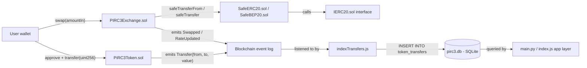

# PiRC3 Token Module

Standard ERC20 token (OpenZeppelin-based) plus an off-chain indexer that logs
`Transfer` events into the PiRC3 SQLite database.

## Contents

```
contracts/
├── PiRC3Token.sol              # ERC20 token contract (uint256 balances, SafeERC20 for recovery)
├── PIRC3Exchange.sol           # Transparent fixed-rate token swap contract
├── interfaces/
│   └── IERC20.sol              # Standard EIP-20 interface
├── libraries/
│   ├── SafeERC20.sol           # Safe transfer/approve wrapper for ERC20 tokens
│   └── SafeBEP20.sol           # Same safety pattern, labeled for BEP20 (BSC) tokens
├── transfers_schema.sql        # SQLite table for indexed Transfer events
├── scripts/
│   └── indexTransfers.js       # Node.js listener that writes events to pirc3.db
└── README.md
```

### PIRC3Exchange.sol

A fixed-rate swap contract between `tokenIn` and `tokenOut`:

- `swap(amountIn)` — users swap tokenIn for tokenOut at the current `rate`
  (tokenOut per 1 tokenIn, scaled by `1e18`). Requires prior ERC20 `approve`.
- `setRate(newRate)` — owner-only, updates the rate. Emits `RateUpdated`.
- `depositLiquidity(amount)` — owner funds the pool with tokenOut.
- `ownerWithdraw(token, to, amount)` — owner-only withdrawal of any token
  held by the contract. This is a **disclosed centralization risk**: anyone
  integrating with this exchange should know the owner can withdraw pooled
  funds. It is not hidden or obfuscated — it's a named, public, logged function.

The rate is just a number the owner sets (e.g. to track an external market
price). The contract itself contains **no formula that manufactures profit** —
swap outcomes are entirely determined by `rate`, which someone has to set
honestly and keep in sync with real market value for the exchange to be fair
to users.

## What this actually does

- `PiRC3Token.sol` is a fixed-supply ERC20 token. All balances and transfer
  amounts use Solidity's native `uint256`. There is no mint-after-deploy,
  pause, or blacklist function — the owner can only `sweep()` *other* ERC20
  tokens accidentally sent to the contract, using `SafeERC20.safeTransfer`
  (which reverts cleanly on non-standard tokens that don't return a bool).
- `indexTransfers.js` connects to an Ethereum-compatible RPC endpoint,
  subscribes to the contract's `Transfer` event, and writes each transfer
  into the `token_transfers` table so it can be queried from SQL instead of
  re-scanning the chain every time.

## Flow diagram



## Setup

### Solidity dependencies

```bash
npm install --save-dev hardhat @openzeppelin/contracts
```

### Deploying (example with Hardhat)

```javascript
// scripts/deploy.js
const { ethers } = require("hardhat");

async function main() {
  const Token = await ethers.getContractFactory("PiRC3Token");
  const token = await Token.deploy(1_000_000); // 1,000,000 whole tokens
  await token.waitForDeployment();
  console.log("PiRC3Token deployed to:", await token.getAddress());
}

main().catch((err) => {
  console.error(err);
  process.exit(1);
});
```

### Running the indexer

```bash
# Apply the extra schema once
sqlite3 pirc3.db < contracts/transfers_schema.sql

# Then run the listener
RPC_URL=https://your-rpc-endpoint \
TOKEN_ADDRESS=0xYourDeployedTokenAddress \
node contracts/scripts/indexTransfers.js
```

## Important notes

- This is a **plain, standard token template** — it does not implement any
  special "formula," guaranteed return, or profit mechanism. Token value is
  determined entirely by the market, not by code in this contract.
- Before deploying anything real, get the contract audited and test
  thoroughly on a testnet.
- If you're building this to distribute or sell to other people, disclose
  exactly what the contract does (fixed supply, no mint, owner-only sweep
  function) rather than attaching unrelated marketing claims to it.
